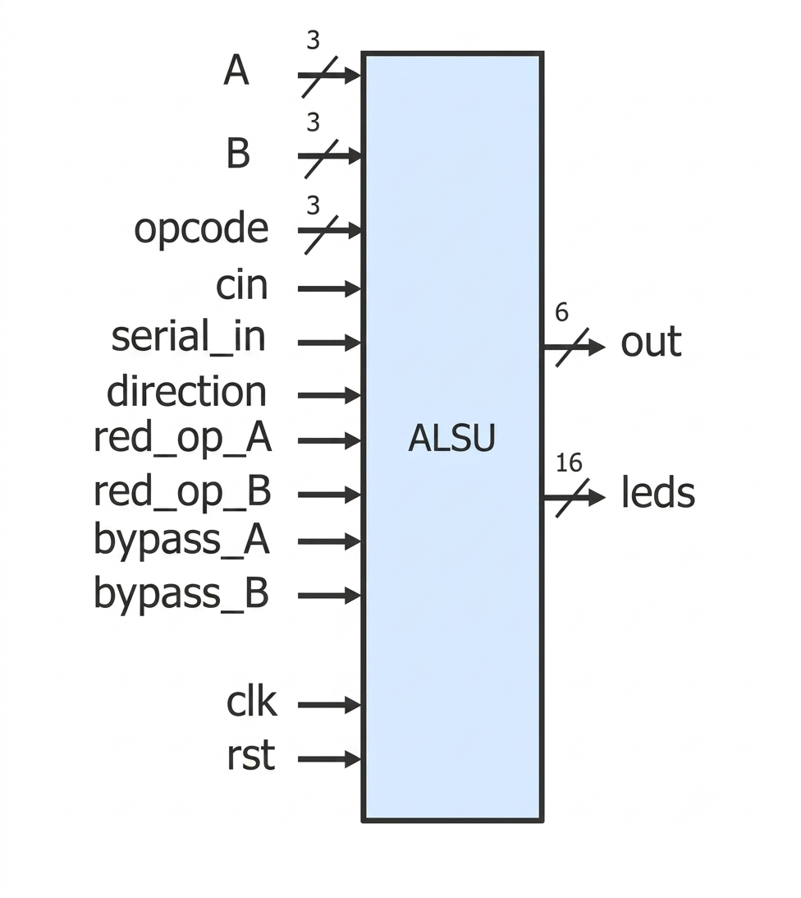
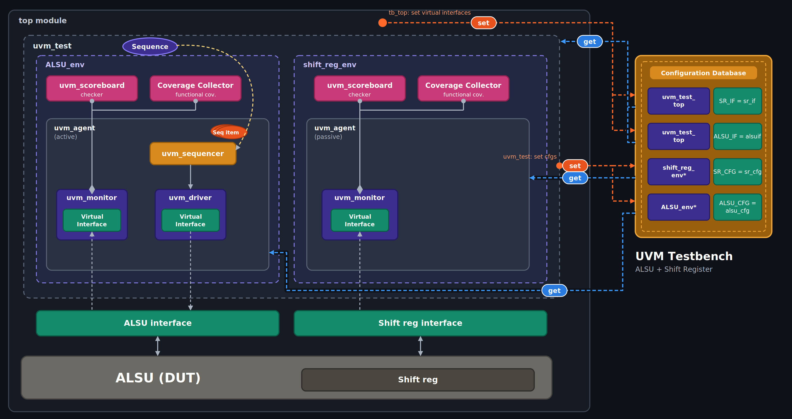
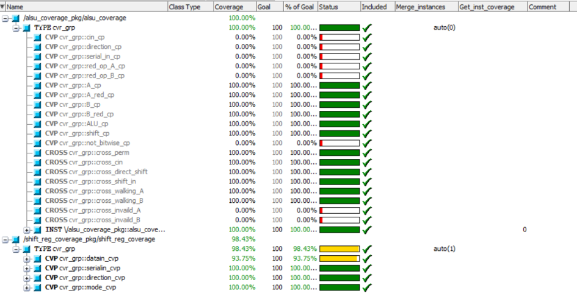
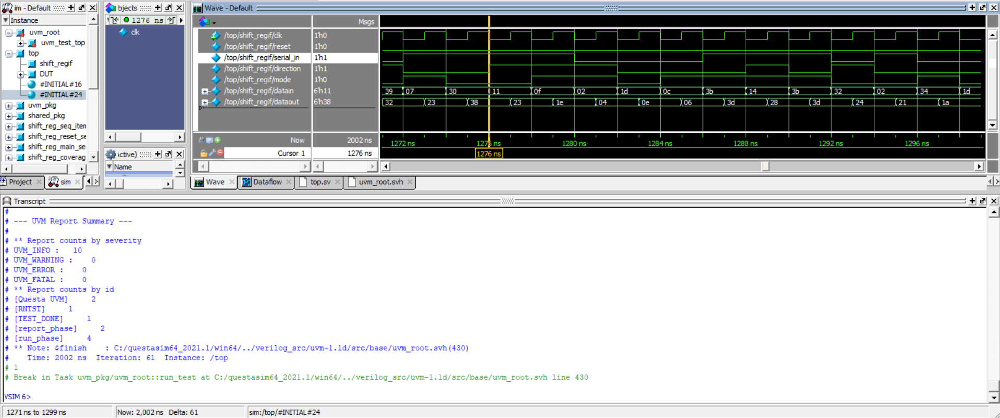
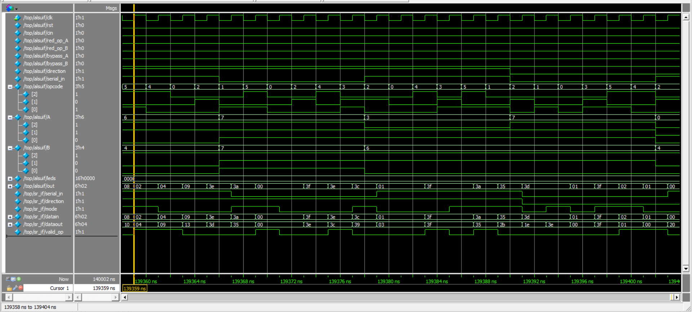

# ALSU UVM Verification

UVM-based verification of a sequential 3-bit signed **Arithmetic Logic Shift Unit (ALSU)** that contains an internal **shift register**. The testbench has two environments: an active ALSU environment that drives the design, and a passive shift register environment that only monitors the shift register interface.

---

## 1. Design Under Test

All inputs (except `clk` and `rst`) are registered through D flip-flops before the logic is evaluated, and all outputs are registered on the rising clock edge.

<p align="center">
  
</p>

### Signals

| Signal | Direction | Width | Description |
| --- | --- | --- | --- |
| `clk` | Input | 1 | Clock |
| `rst` | Input | 1 | Active-high asynchronous reset |
| `A`, `B` | Input | 3 (signed) | Operands |
| `cin` | Input | 1 | Carry-in |
| `serial_in` | Input | 1 | Serial input for the shift operation |
| `direction` | Input | 1 | 1 = left, 0 = right |
| `opcode` | Input | 3 | Operation select |
| `red_op_A`, `red_op_B` | Input | 1 | Reduction operation on A / B |
| `bypass_A`, `bypass_B` | Input | 1 | Pass A / B directly to `out` |
| `out` | Output | 6 (signed) | Result |
| `leds` | Output | 16 | Warning display |

### Parameters

| Parameter | Default | Description |
| --- | --- | --- |
| `INPUT_PRIORITY` | `"A"` | Priority when both bypass flags, or both reduction flags, are asserted |
| `FULL_ADDER` | `"ON"` | Enables `cin` during addition |

### Opcode table

| Opcode | Operation | Behavior |
| --- | --- | --- |
| `000` | OR | Bitwise `A \| B`, or reduction (`\|A` / `\|B`) if `red_op` is high |
| `001` | XOR | Bitwise `A ^ B`, or reduction (`^A` / `^B`) if `red_op` is high |
| `010` | ADD | `A + B + cin` (if `FULL_ADDER=="ON"`), else `A + B` |
| `011` | MULT | `A * B` |
| `100` | SHIFT | 1-bit shift using `serial_in`, according to `direction` |
| `101` | ROTATE | 1-bit circular shift, according to `direction` |
| `110` / `111` | INVALID | Invalid opcodes (`INVALID_6`, `INVALID_7`) |

### Exception rules

- **Invalid conditions:** `opcode` is `110` or `111`, or `red_op_A` / `red_op_B` is asserted with an operation other than OR / XOR.
- **Invalid behavior:** `out` is cleared and `leds` blink (`~leds` toggles every clock cycle).
- **Bypass override:** `bypass_A` or `bypass_B` bypasses normal processing and the invalid state, passing `A` or `B` to `out` (priority resolved by `INPUT_PRIORITY`).

### Shift register inside the ALSU

The SHIFT and ROTATE operations are executed by a `shift_reg` module instantiated inside the ALSU. It is combinational (no clock, no reset):

| `shift_reg` port | Connected to |
| --- | --- |
| `serial_in` | `serial_in_reg` |
| `direction` | `direction_reg` |
| `mode` | `opcode_reg[0]` (0 = shift, 1 = rotate) |
| `datain` | `out` |
| `dataout` | `out_shift_reg` |

For opcodes 4 and 5, the ALSU assigns `out <= out_shift_reg`.

---

## 2. Verification Environment

<p align="center">
  
</p>

The test (`alsu_test`) creates two environments:

| Environment | Agent mode | Role |
| --- | --- | --- |
| `alsu_env` | `UVM_ACTIVE` | Drives the ALSU interface, checks `out` and `leds`, collects ALSU coverage |
| `shift_reg_env` | `UVM_PASSIVE` | Only monitors the shift register interface, checks `dataout`, collects shift register coverage |

### Components

Each environment has the same structure: agent (sequencer, driver, monitor), scoreboard, and coverage collector. The monitor sends transactions through an analysis port to the scoreboard and the coverage collector.

| Component | Notes |
| --- | --- |
| Sequence item | Randomized inputs and sampled outputs. The ALSU item holds all the constraints. |
| Reset sequence | Asserts `rst` once at the start of the test (ALSU only). |
| Main sequence | Two stimulus phases, described below (ALSU only). |
| Driver / sequencer | Built and connected only if `is_active == UVM_ACTIVE`. |
| Monitor | Always built. ALSU monitor samples at the falling clock edge. The shift register monitor samples every 2 ns (`#2`), since the shift register has no clock. |
| Scoreboard | Contains the golden model and compares the outputs, with a counter for correct and failed transactions. |
| Coverage collector | Covergroup sampled from the monitor transactions. |

### Configuration database

| Key | Set by | Value |
| --- | --- | --- |
| `ALSU_IF` | `top` | Virtual interface of the ALSU |
| `SR_IF` | `top` | Virtual interface of the shift register |
| `ALSU_CFG` | `alsu_test` (path `alsu_env*`) | ALSU config object (virtual interface, `is_active = UVM_ACTIVE`) |
| `SR_CFG` | `alsu_test` (path `shift_reg_env*`) | Shift register config object (virtual interface, `is_active = UVM_PASSIVE`) |

The shift register interface in `top.sv` is connected to the ALSU internals with `assign` statements (`serial_in_reg`, `direction_reg`, `opcode_reg[0]`, `out`, `out_shift_reg`). It also has a `valid_op` signal, which is high while the ALSU executes a valid SHIFT or ROTATE (no bypass, no reduction operation). The shift register coverage samples only when `valid_op` is high, while its scoreboard checks every sample.

### Packages

The two environments use separate shared packages (`alsu_shared_pkg` and `shift_reg_shared_pkg`), since both define enumerators such as `SHIFT`, `ROTATE`, `RIGHT` and `LEFT`.

---

## 3. Stimulus Generation

The ALSU sequence item randomizes the inputs under these constraints:

| Constraint | Purpose |
| --- | --- |
| `crst` | `rst` is asserted 2% of the time |
| `adder_inputs` | For ADD / MULT, `A` and `B` take the corner values (`MAXPOS`, `ZERO`, `MAXNEG`) 80% of the time. For OR / XOR with a reduction operation, the reduced operand takes a walking-ones value 80% of the time and the other operand is 0. For the other opcodes, `red_op_A` / `red_op_B` are asserted 20% of the time. |
| `otherr` | Valid opcodes 80% of the time, invalid opcodes 20% of the time. `bypass_A` / `bypass_B` are asserted 2% of the time. |
| `unique_opcode` | `op_arr` holds the six valid opcodes in a random unique order, used by the second phase |

The main sequence runs two phases, after the reset sequence:

1. **Phase 1 (10,000 items):** fully constrained random stimulus, with `unique_opcode` disabled.
2. **Phase 2 (10,000 x 6 items):** only `unique_opcode` is enabled, and `rst`, bypass and reduction are forced to 0. Each randomization walks through all six valid opcodes in a random order.

---

## 4. Checking

### ALSU scoreboard

The golden model works on shadow copies of the registered inputs (`A_reg`, `B_reg`, `cin_reg`, `opcode_reg`, and so on), mirroring the DUT's input registers. On each transaction it:

- clears `out` and `leds` and the shadow registers on reset,
- toggles `leds` while the registered inputs are invalid, and clears them otherwise,
- computes `out` with the same priority as the DUT: bypass, then invalid, then the operation,
- updates the shadow registers from the current inputs.

`out` and `leds` are compared against the DUT outputs.

### Shift register scoreboard

The shift register is combinational, so the model computes `dataout` directly from the sampled `datain`, `serial_in`, `direction` and `mode`.

---

## 5. Functional Coverage

The ALSU covergroup (`cvr_grp`) is sampled by the coverage collector. It skips reset items and items where both bypass signals are high.

| Coverage item | Description |
| --- | --- |
| `A_cp`, `B_cp` | Zero, max positive, max negative and default values of the operands |
| `A_red_cp`, `B_red_cp` | Walking-ones values on the operand being reduced |
| `ALU_cp` | Shift, arithmetic and bitwise opcode groups, the full opcode transition `OR => XOR => ADD => MULT => SHIFT => ROTATE`, and illegal bins for opcodes 6 and 7 |
| `cross_perm` | `A_cp` x `B_cp` x `ALU_cp` |
| `cross_cin` | `cin` x arithmetic opcodes |
| `cross_direct_shift` | `direction` x shift / rotate opcodes |
| `cross_shift_in` | `serial_in` x SHIFT opcode |
| `cross_walking_A`, `cross_walking_B` | Walking-ones operand x other operand x bitwise opcodes |
| `cross_invaild_A`, `cross_invaild_B` | Reduction operation with a non-bitwise opcode (illegal bins) |

The shift register covergroup has coverpoints on `datain`, `serial_in`, `direction` and `mode`.

<p align="center">
  
</p>

Total covergroup coverage reached **99.21%**. The full per-covergroup and per-bin details are in **`alsu_coverage_report.txt`**, generated by QuestaSim.

---

## 6. Verification Plan

| Label | Description                                             | Stimulus Generation                 | Functional Coverage | Functionality Check                                                            |
| ----- | ------------------------------------------------------- | ----------------------------------- | ------------------- | ------------------------------------------------------------------------------ |
| ALSU_1 | When the reset is asserted, the outputs out and leds must be low | Directed at the start of simulation, then randomized during simulation (rst asserted 2% of the time) | - | A checker in the scoreboard comparing out and leds with the golden model, which clears its outputs and input registers on reset |
| ALSU_2 | When bypass_A or bypass_B is high, out must equal A or B respectively, regardless of the opcode, and A has priority when both are high (INPUT_PRIORITY = "A") | Randomized during simulation (each bypass high 2% of the time) | - | A checker in the scoreboard comparing the out output with the golden model output |
| ALSU_3 | OR operation: out = A \| B, or the reduction OR of A when red_op_A is high, or of B when red_op_B is high (A has priority when both are high) | Randomized during simulation, with walking-ones values on the reduction operand (80%) and the other operand forced to 0 | A_red_cp, B_red_cp, cross_walking_A, cross_walking_B, and the bitwise bins of ALU_cp | A checker in the scoreboard comparing the out output with the golden model output |
| ALSU_4 | XOR operation: out = A ^ B, or the reduction XOR of A when red_op_A is high, or of B when red_op_B is high (A has priority when both are high) | Randomized during simulation, with walking-ones values on the reduction operand (80%) and the other operand forced to 0 | A_red_cp, B_red_cp, cross_walking_A, cross_walking_B, and the bitwise bins of ALU_cp | A checker in the scoreboard comparing the out output with the golden model output |
| ALSU_5 | ADD operation: out = A + B + cin when FULL_ADDER is "ON" | Randomized during simulation, with A and B taking MAXPOS, ZERO or MAXNEG 80% of the time | cross_perm (A_cp, B_cp, ALU_cp) and cross_cin | A checker in the scoreboard comparing the out output with the golden model output |
| ALSU_6 | MULT operation: out = A * B | Randomized during simulation, with A and B taking MAXPOS, ZERO or MAXNEG 80% of the time | cross_perm (A_cp, B_cp, ALU_cp) | A checker in the scoreboard comparing the out output with the golden model output |
| ALSU_7 | SHIFT operation: out shifts left or right by one bit and takes serial_in as the new bit, according to direction | Randomized during simulation | cross_direct_shift and cross_shift_in | A checker in the scoreboard comparing the out output with the golden model output |
| ALSU_8 | ROTATE operation: out rotates left or right by one bit, according to direction | Randomized during simulation | cross_direct_shift | A checker in the scoreboard comparing the out output with the golden model output |
| ALSU_9 | When the opcode is invalid (6 or 7), or a reduction operation is requested with an opcode other than OR/XOR, out must be 0 | Randomized during simulation (invalid opcodes 20% of the time, reduction operations 20% of the time with non-bitwise opcodes) | ALU_cp invalid bins, cross_invaild_A and cross_invaild_B | A checker in the scoreboard comparing the out output with the golden model output |
| ALSU_10 | The leds output must toggle every cycle while the inputs are invalid and return to 0 otherwise | Randomized during simulation | cross_invaild_A and cross_invaild_B | A checker in the scoreboard comparing the leds output with the golden model output |
| ALSU_11 | Verify every valid opcode in sequence (OR, XOR, ADD, MULT, SHIFT, ROTATE) with reset, bypass and reduction disabled | Randomized during simulation, using the unique-opcode constraint to walk through the six opcodes | Bins_trans of ALU_cp | A checker in the scoreboard comparing the out and leds outputs with the golden model outputs |
| SR_1 | SHIFT mode of the shift register: dataout shifts datain by one bit, left or right according to direction, taking serial_in as the new bit | Driven by the ALSU agent (the shift register agent is passive and only monitors the interface) | datain_cvp, serialin_cvp, direction_cvp and mode_cvp, sampled only while the ALSU executes a valid shift or rotate | A checker in the shift register scoreboard comparing dataout with the golden model output |
| SR_2 | ROTATE mode of the shift register: dataout rotates datain by one bit, left or right according to direction | Driven by the ALSU agent (the shift register agent is passive and only monitors the interface) | datain_cvp, serialin_cvp, direction_cvp and mode_cvp, sampled only while the ALSU executes a valid shift or rotate | A checker in the shift register scoreboard comparing dataout with the golden model output |

---

## 7. Results

<p align="center">
  
</p>

| Item | Result |
| --- | --- |
| ALSU scoreboard | 70,001 successful, 0 failed |
| Shift register scoreboard | 70,001 successful, 0 failed |
| `UVM_ERROR` / `UVM_FATAL` | 0 / 0 |
| Covergroup coverage | 99.21% |
| Simulation end time | 140,002 ns |

The 70,001 transactions are 1 reset item, 10,000 random items from phase 1, and 10,000 x 6 items from phase 2.

**Illegal bin messages:** the transcript also shows QuestaSim `vsim-8567` messages about illegal bins (for example `cross_invaild_B_1`). These come from the covergroup's `illegal_bins` and are not UVM errors. The stimulus generates invalid opcodes and reduction operations with non-bitwise opcodes on purpose, to check the invalid behavior of the ALSU, and those samples land in the illegal bins.

### Waveform

<p align="center">
  
</p>

---

## 8. Project Structure

```
alsu_sr_uvm/
├── ALSU.v                    # DUT (instantiates shift_reg)
├── shift_reg.v               # Combinational shift register
├── alsu_shared_pkg.sv        # ALSU enums and parameters
├── shift_reg_shared_pkg.sv   # Shift register enums
├── alsu_if.sv                # ALSU interface
├── shift_reg_if.sv           # Shift register interface
├── alsu_config.sv            # ALSU config object
├── shift_reg_config.sv       # Shift register config object
├── alsu_seq_item.sv          # ALSU sequence item (constraints)
├── shift_reg_seq_item.sv     # Shift register sequence item
├── alsu_sequencer.sv
├── shift_reg_sequencer.sv
├── alsu_driver.sv
├── shift_reg_driver.sv
├── alsu_monitor.sv
├── shift_reg_monitor.sv
├── alsu_agent.sv
├── shift_reg_agent.sv
├── alsu_scoreboard.sv        # ALSU golden model and checker
├── shift_reg_scoreboard.sv
├── alsu_coverage.sv          # ALSU covergroup
├── shift_reg_coverage.sv
├── alsu_env.sv
├── shift_reg_env.sv
├── alsu_main_sequence.sv
├── alsu_reset_sequence.sv
├── alsu_test.sv              # Test creating both environments
├── top.sv                    # Top module
├── src_files.list            # Compile order
└── alsu_coverage_report.txt  # QuestaSim coverage report
```

---

## 9. How to Run

From the project folder, with QuestaSim:

```
vlib work
vlog -f src_files.list +cover -covercells
vsim -voptargs=+acc work.top -classdebug -uvmcontrol=all -cover
add wave /top/alsuif/*
add wave /top/sr_if/*
coverage save alsu.ucdb -onexit 
run -all
```

To generate a coverage report from the saved database:

```
vcover report alsu.ucdb -details -annotate -output alsu_coverage_report.txt
```
